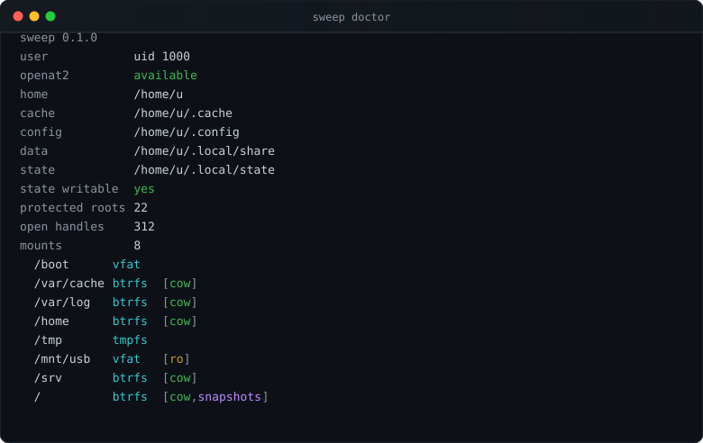

<div align="center">

# sweep

**Terminal cleanup for Arch Linux, with exactly one way to delete a file.**

[](https://github.com/ulaskizilay/sweep/actions/workflows/ci.yml)
[](LICENSE)
[](rust-toolchain.toml)
[](#requirements)



<sub>Example output. The mount list is trimmed; the flags are real.</sub>

</div>

---

## Status

> **Pre-alpha.** `doctor`, `rules`, `clean`, `purge`, `installer`, `aur`,
> `status`, `analyze`, `history`, `optimize` and `uninstall` work. `clean` prints
> the plan, asks once, then deletes through the single funnel and writes one
> operation-log row per decision;
> `--dry-run` stops before the question and writes nothing at all. The catalog is
> 131 rules over sixteen sections, and the section whose loss may not be
> recoverable — downloaded model weights — is skipped unless you name it. System
> caches are swept through a second process: `sweep` never runs as root, so it
> plans as you and asks before elevating.

| Milestone | Scope | State |
|---|---|---|
| M0 | workspace, CI, `doctor` | done |
| M1 | path policy, plan, deletion funnel, operation log, filesystem facts | done |
| M2 | TOML rule engine, `rules list\|verify`, `clean --dry-run` | done |
| M3a | applying the plan: confirmation gate, operation log, exit codes | done |
| M3b | model caches: Hugging Face blob/snapshot scanner, opt-in section | done |
| M4a | system caches through `run0`/`sudo`, the privilege boundary | done |
| M4b | `paccache` keep-versions semantics, rotated logs | done |
| M5a | project artifacts: the manifest-gated `purge` | done |
| M5b | `installer`: downloaded package and image files | done |
| M5c | AUR helper caches: `aur` | done |
| M6a | `status`: a read-only health summary, text and JSON | done |
| M6b | `analyze`: the disk explorer and the large-file report | done |
| M7a | `history` and `optimize`: what sweep did, and the user-side indexes | done |
| M7b | `uninstall`: pacman's transaction, the leftover scan | done |
| M8 | packaging, man page, completions | done |

## Why

Every disk cleaner is a program that runs as you, walks your home directory, and
calls `rm`. The interesting question is not which folders it picks. It is what
stops it when it picks the wrong one: a bug in a glob, a symlink pointing into
`/usr`, a database someone still has open, a snapshot it cannot see.

`sweep` is built around that question. Deletion is not a helper function called
from thirty places. It is one function, reachable only by a path that passed
twenty checks, and it removes exactly one directory entry per syscall.

## How it works

<div align="center">

<picture>
  <source media="(prefers-color-scheme: dark)" srcset="docs/assets/pipeline-dark.svg">
  
</picture>

</div>

Four properties hold by construction rather than by discipline:

- **`PlanItem` has no public constructor.** The only function that builds one is
  `Plan::push`, and it calls `validate` first. A caller cannot hand the funnel a
  path that was never validated without editing `plan.rs`.
- **One function deletes anything** (`sweep_core::funnel::apply`). Everything
  else in the codebase is read-only with respect to the filesystem.
- **Any error is a refusal.** "We could not verify it" is never "it is safe".
  A missing mount table entry, an unreadable `/proc` entry, a failed `ioctl` —
  all of them deny.
- **Deletion cannot recurse.** `unlinkat` on a non-empty directory fails with
  `ENOTEMPTY`. Recursive deletion is not a code review question, it is a syscall
  the kernel refuses.

## What it protects

Each of these is a refusal with a stable reason code, not a warning:

| Target | Why |
|---|---|
| `/usr`, `/bin`, `/lib`, `/etc`, `/boot`, `/opt`, `/var/lib`, … | package-manager ownership is not negotiable; the list is compile-time and no config can narrow it |
| `~/.ssh`, `~/.gnupg`, `~/.password-store`, keyrings | identity data is never a cache |
| `~/.cache`, `~/.config`, `~/.local/share`, `~/.local/state` themselves | deleting the base directory defeats every per-rule decision inside it |
| read-only and unknown mounts | an unknown mount means a truncated mount table, not a permission |
| `/.snapshots`, `@@snapshots`, `/timeshift` | inside a btrfs snapshot the bytes are shared and the rollback point is not replaceable |
| mount points | unmounting is not cleaning |
| files owned by another user | not yours, not ours to remove |
| sticky parents, immutable files | the kernel is already protecting them |
| files held open by a process | answered from one `/proc` pass, indexed by inode; `-wal`/`-shm` are refused when their database is open |

Symlinked ancestors are **followed and then re-checked**, not blanket-denied.
`~/.cache -> /mnt/ssd/cache` is a normal setup; refusing it would mean the tool
silently cleans nothing on a large fraction of machines. The resolved physical
path is re-tested against the same list, deny-only, and the delete happens
through a directory handle opened with `RESOLVE_NO_SYMLINKS`.

The full contract — including the eleven residual risks that are *not* solved —
is in [`docs/SAFETY.md`](docs/SAFETY.md).

## The rules

The catalog is TOML, and it is data rather than code: `rules/01-system.toml`
through `rules/16-model-caches.toml`, 131 rules over sixteen sections, 117
enabled in this build. Each rule names a root, a kind, a retention and the
sentence that justifies deleting there.

```bash
$ sweep rules list
sweep rules — 16 packs, 131 rules, 117 enabled

  section            rules  enabled
  system                 8        5
  user-essentials        6        6
  ...
  dev-tools             43       43
  ...
  model-caches           3        3  opt-in

  model-caches is opt-in: `sweep clean` leaves it alone until you name it with `--only`.

  system
    system.fontconfig.cache        dir-sweep      now  root  /var/cache/fontconfig
    system.fwupd.cache             dir-age        30d  root  /var/cache/fwupd
    system.log.rotated             file-pattern   7d   root  /var/log
    system.man.cache               dir-sweep      now  root  /var/cache/man
    system.pacman.package-cache    pkg-cache    2v/7d  root  /var/cache/pacman/pkg

  dev-tools
    dev.cargo.crate-cache          file-pattern   30d  on    /home/u/.cargo/registry/cache
    dev.go.build-cache             tool-cache     now  on    /home/u/.cache/go-build

  model-caches
    model.huggingface.hub          hf-cache       90d  on    /home/u/.cache/huggingface/hub
    model.torch.checkpoints        dir-age        90d  on    /home/u/.cache/torch/hub/checkpoints
    model.whisper.cache            dir-age        90d  on    /home/u/.cache/whisper
```

Nine kinds (`dir-sweep`, `dir-age`, `file-pattern`, `tool-cache`, `trash-empty`,
`hf-cache`, `pkg-cache`, `project-artifacts`, `report-only`) cover every target.
`dir-age` keeps a whole subtree unless *every* entry in it is idle past the
cutoff and nothing in it was left alone.

`pkg-cache` exists because the package cache has no sensible age cutoff. It
keeps the newest *N* versions of each package, compared with pacman's own
`vercmp`, so `1.10` outranks `1.9` and a machine that has not been upgraded in
months still has the archive of the kernel it is running. A version downloaded
in the last `keep_days` is kept regardless: that is a downgrade in progress.
On a stock Arch cache, `sweep clean --only system` planned the same 170 files,
byte for byte, as `paccache -d -k2` when this was verified.

Rules that are wrong do not load: a root inside `/usr`, a duplicate id, a typo
in a key. A user overlay at `~/.config/sweep/rules.d/*.toml` may add rules but
not replace a built-in one. The schema, the retention semantics and the full
list of load-time refusals are in [`docs/RULES.md`](docs/RULES.md).

### Your own ignore file

A rule's `exclude` is the catalog author saying "not this one". Your ignore file
is you saying it, and it survives an upgrade because it is yours:

```bash
$ cat ~/.config/sweep/ignore
# a checkout I rebuild by hand
~/code/vendor-checkout
# disk images, wherever they are
*.iso
```

One pattern per line, `#` starts a comment, and the glob language is the one the
rules already use: `*`, `?`, `**`. A line protects the path **and everything
below it**, so `~/work` is enough. A pattern without `/` matches a name at any
depth (`*.iso`); one with `/` is anchored, to `$HOME` for a bare line and to `/`
for one starting with `/` or `~`.

`clean`, `purge`, `installer` and `aur` skip a protected path and say how many
they skipped, so you can tell the line took effect. `analyze` and `uninstall`
act on a path or a package you named in the same breath, and refusing those
would be refusing an instruction you just gave.

A line that cannot be understood refuses the whole run and names the file, the
line and the fix. Sweeping past a typo in a protection file is the one outcome
you would not expect, and it is the one you cannot undo.

### Project artifacts need a manifest, not a directory name

`sweep purge` removes the build output of the projects in your home:
`node_modules`, `target`, `.venv`, `vendor`, `dist`, `build`, `.terraform`,
`htmlcov`, `.zig-cache`. The rule does not have a list of names to delete; it
has a list of manifests, and a directory is only a target when the manifest that
produces it sits beside it:

```
web/package.json      + web/node_modules       →  node_modules is a build artifact
rustproj/Cargo.toml   + rustproj/target        →  target is a build artifact
stray/node_modules                             →  no manifest, left alone
```

That gate is what makes it safe to point at `$HOME`. There is no vendor-wide
prefix, no `find -name node_modules`, and no wildcard that a typo can widen: a
`node_modules` with no `package.json` is reported as skipped, with the reason.
`.git` is never a target, and the walk never descends into an artifact, so the
`package.json` inside a published dependency does not make it a project.

One directory is all-or-nothing. If any part of a `target/` tree cannot be read,
the whole artifact stays: a half-removed tree is worse than either state.
Symbolic links inside an artifact are removed as links, never followed — that is
the one place sweep unlinks a link, and it is why the venv's `bin/python3` and
`node_modules/.bin` go with the directory.

`sweep purge` is its own command because the work is different. `clean` opens
paths the rule already names; `purge` walks your home, so it needs its own
preview and its own confirmation. A bare `sweep clean` lists the section as
`belongs to another command` instead of scanning it.

### An AUR clone is a recipe, not a cache

`sweep aur` removes the `.pkg.tar.*` archives that `paru`, `yay` and `trizen`
build under `~/.cache`, and nothing else in those directories. The clone, the
`PKGBUILD` and the sources stay.

The distinction is what the files are for. A `PKGBUILD` you edited exists
nowhere else — not in the AUR, not in the binary package — so a directory sweep
of a helper cache can destroy work that took an hour to get right. The archive
beside it is output: `makepkg` rebuilds it from the recipe that stays. Sources
are kept for a subtler reason: if upstream republished a tarball, the cached
copy is the one whose checksum still matches, so deleting it can leave a package
that no longer builds until the recipe is fixed by hand.

The clone directories are still reported, with their size and with the sentence
saying they were not taken. "There is 12 GiB here you can't have automatically,
and here is why" is a more useful answer than silence.

### An installer is not the installed program

`sweep installer` removes the archive: the `.pkg.tar.zst` downloaded instead of
using the mirror, the `.deb` for a foreign package, the `.iso` burned once, the
`.AppImage` that was copied into `/usr/local/bin`. The package database, the
unpacked files and the application's own state are untouched, so removing the
archive never uninstalls anything.

The rule is narrow on purpose. It reads `~/Downloads` two levels deep and it
matches six suffixes, because the name is the only evidence there is. It does
not take `.zip`, `.tar.gz` or `.7z` (as likely to be a source export or a backup
as an installer), and it does not take `.exe` or `.msi` (a portable Windows
program *is* that file; removing it is an uninstall, which is a different
command with a different confirmation). An `.iso` under `~/VMs` stays too: a
disk image a virtual machine is running is not a download someone forgot.

### Model weights are opt-in

`model-caches` is the one section a bare run does not scan. The rules are listed
with status `opt-in` instead of disappearing, and the summary says the section
was not scanned rather than reporting it as empty. `--only model-caches` is the
consent.

The reason is recoverability, not caution about size. A gated repository needs a
licence acceptance, a private one needs a token, and an offline machine can
reach neither, so "download it again" is not always true.

That section also needs its own kind. `huggingface_hub` stores each file once as
`blobs/<etag>` and links it into `snapshots/<revision>/<path>`, so an ordinary
cache sweep would delete the blobs and leave every snapshot dangling: the model
looks installed, fails at load time, and never re-downloads because its revision
is still in `refs/`. `hf-cache` therefore plans only blobs no snapshot link
resolves to, plus abandoned `*.incomplete` downloads, and it preserves a
repository whose snapshot tree cannot be read completely.

### Root, without becoming root

`sweep` refuses to run as root at all. That is not modesty: every path it reads
— the catalog overlay, the state directory, the log — belongs to the user, and a
process that resolves them as root is reading a different machine's worth of
configuration.

System caches still get swept, in two steps with a question in between. The user
process does the planning, because reading `/var/cache/man` needs no privilege.
Then `clean` asks a second question — `--yes` answered "delete this plan", not
"become root" — and re-executes the same binary through `run0` or `sudo` with a
fixed argument list and the plan on standard input. No shell is involved, so a
filename cannot become an argument.

The elevated child does not trust its parent: it rebuilds the list of allowed
roots from the compiled catalog, refuses a rule id it has never heard of,
re-checks each inode, re-derives each rule's *selection* (which rotated logs,
which package versions) instead of trusting the path list, and re-runs the whole
validation as root before removing anything. It also never writes the log. It prints one JSON line per item and the
user process appends them, so root never opens a file inside your home.

A pipe has nobody to ask, so a non-interactive run without `--privileged` leaves
the root-owned items alone and says so. Nothing is deleted as you by accident,
and nothing is deleted as root without a second answer.

## Requirements

- Arch Linux, or another Linux with `/proc/self/mountinfo`
- Linux 5.6+ for `openat2`; older kernels use a component-walk fallback with the
  same verdicts
- Rust 1.82+ to build

`sweep` refuses to run as root (exit code 78). It reads your config, your cache
paths and your logs; as root those resolve to a different user's tree. The
sections that genuinely need privilege will ask for it one operation at a time.

## Install

The tracking package builds `main`, and it lives in this repository until it is
submitted to the AUR:

```bash
git clone https://github.com/ulaskizilay/sweep.git
cd sweep/packaging/sweep-cli-git
makepkg -si
```

Or build it yourself:

```bash
git clone https://github.com/ulaskizilay/sweep.git
cd sweep
cargo build --release --locked
./target/release/sweep doctor
```

A stable `sweep-cli` package needs a `V*` tag, a tarball checksum and
`updpkgsums`; [`packaging/README.md`](packaging/README.md) lists what it takes,
and why neither package is faked here.

### Completions and the man page

Both are generated from the same `clap` definition the parser uses, so an option
that exists in `--help` exists in all of them:

```bash
sweep completions bash > /usr/share/bash-completion/completions/sweep
sweep completions zsh  > /usr/share/zsh/site-functions/_sweep
sweep completions fish > /usr/share/fish/vendor_completions.d/sweep.fish

sweep __manpage            > /usr/share/man/man1/sweep.1
sweep __manpage clean      > /usr/share/man/man1/sweep-clean.1
```

Nothing is written into `$HOME`: the commands print, and moving the output into
place is the package manager's job. `__manpage` takes a command path, because the
top page refers to `sweep-clean(1)` and a reference to a page that is not
installed is a dead end; it is hidden from `--help` and from the completions,
because it is a build helper, not a command to type.

## Commands

| Command | Purpose | State |
|---|---|---|
| `sweep doctor` | what sweep can see: mounts, base directories, capabilities; `--json` for scripts | works |
| `sweep rules list` / `verify` | the catalog, and whether built-ins plus your overlay compile | works |
| `sweep clean --dry-run` | the plan, per section and per rule, with the reason every skip happened | works |
| `sweep clean` | reclaim cache, log and build space; asks once, then deletes | works |
| `sweep clean --only model-caches` | the opt-in section: model blobs, checkpoint caches | works |
| `sweep clean --privileged` | also sweep root-owned system caches, through `run0` or `sudo` | works |
| `sweep purge` | `node_modules`, `target`, virtualenvs — only where a manifest says a build made them | works |
| `sweep installer` | package and image files in `~/Downloads` that were never touched again | works |
| `sweep status` | disk, inodes, memory, load, package cache, orphans, trash, orphaned user units, last sweep; `--json` for scripts | works |
| `sweep analyze` | the disk explorer, and `--largest` for a pipe; the only deletion is a move to the trash | works |
| `sweep history` | every run from the operation log, grouped by session; `--json` for scripts | works |
| `sweep optimize` | rebuild the user-side indexes through the tools that own them; system-wide tasks are named, never run as root | works |
| `sweep uninstall` | an inventory, or pacman's own removal transaction; leftovers go to the trash | works |
| `sweep aur` | built `.pkg.tar.*` archives in helper caches; clones and sources are reported, never taken | works |
| `sweep completions <shell>` | the bash, zsh or fish completion script, printed for the package build | works |
| `sweep __manpage` | the man pages, printed for the package build | internal |

`sweep clean` is two phases. It plans — load the catalog, scan the roots,
validate every candidate — and only then asks. The question is skipped with
`--yes`, and a run whose stdin is not a terminal refuses without it (exit 5) and
deletes nothing, so a cron job cannot answer a prompt with its own pipe. The
applied run writes one row per decision to
`~/.local/state/sweep/operations.jsonl` under a `clean-<unix>` session and exits
1 if a syscall failed, with the reason recorded for each item.

Sizes are the sum of `st_blocks`, which is what the inodes account for. On a
copy-on-write filesystem the space actually returned can be smaller when extents
are shared with a snapshot or a reflink, and the report says so when a rule root
sits on one.

`sweep doctor` is also the answer to "why did it skip everything?", so a bug
report can be its output pasted whole. `sweep rules list --verbose` answers the
narrower version: which rule, which requirement, which retention.

### Status is a snapshot, not a monitor

`sweep status` prints one screen and exits. It reads `/proc`, `statvfs`, the
package cache, the operation log and the user unit directory, and it writes
nothing at all — no state file, no lock, no log row, so it is safe to put in a
shell prompt or run every minute from a timer if you want to. It is not a daemon,
it keeps no history, and it has no alerts.

Every row is either a number or `— not available`. A row that cannot be measured
says so instead of printing a plausible zero: a tree the walk could not finish
enumerating is "not available", never a smaller size. `--verbose` adds the reason
it could not be measured; the default keeps the screen quiet.

The actionable rows name the command that acts on them (`sweep clean --only
system` for a package cache, `sudo pacman -Rns $(pacman -Qtdq)` for orphans),
because a health summary that cannot be acted on is a dashboard. Trash appears
with its size, and `clean` empties it as part of the same plan: each payload goes
with the `.trashinfo` record that names it, so nothing is left offering a restore
that cannot work. `analyze` and `uninstall` are what put entries there in the
first place, which is what keeps that step reviewable.

One row reads configuration rather than counters. `user units` checks whether
the program each `~/.config/systemd/user/*.service` starts still exists: a unit
whose `ExecStart` is gone cannot start, and systemd says so only into a log. The
row names the unit and `systemctl --user disable --now <unit>`, and disables
nothing itself. A command holding a systemd specifier (`%h`) or a variable cannot
be expanded from here, so that unit counts as not checkable instead of being
reported as broken — a false alarm sends you to a unit that is fine.

`--json` prints the same facts with stable field names, one document, for a
script that should not parse the prose. The last-run row sums the newest session
in the operation log; if a session is longer than the 64 KiB tail window, the row
says `at least N items` rather than printing a short total as if it were whole.

### The explorer moves, it does not delete

`sweep analyze` without arguments opens a full-screen explorer over `$HOME`, or
over the directory you name. It reads sizes, sorts by size, name or age, filters
by name, and descends into a directory. It writes nothing until you press `d` and
then `y`, and that pair moves the selected entry to the freedesktop trash in
`$XDG_DATA_HOME/Trash` — `files/` for the payload, `info/` for the record that
lets your desktop restore it. Every move appends one `TRASHED` row to the
operation log.

The same path policy as every other command applies: protected roots, `~/.ssh`,
keyrings, the state directory and the trash itself are refused, and so is a path
with a symbolic link anywhere above it. A link is moved as a link; what it points
at is never touched. `renameat(2)` refuses to cross a filesystem, so an entry on
another mount is a refusal rather than a copy that can be interrupted halfway:
sweep does not yet implement the per-mount top directory trash that would make it
work, and saying so is better than half a move.

`--largest` is the mode for a pipe, a script or a machine without a terminal:

```console
$ sweep analyze --largest 3
sweep analyze — the 3 largest files below /home/you

        size   modified  path
     3.8 GiB    10 days  /home/you/.android/avd/phone.avd/snapshots/ram.bin
     2.4 GiB    10 days  /home/you/.android/avd/phone.avd/userdata-qemu.img.qcow2
     1.3 GiB      today  /home/you/.cache/paru/clone/tool/tool-1.2-1-x86_64.pkg.tar.zst

  scanned 423,506 files (499,838 entries, 63.3 GiB) in 10.3s — the entry budget stopped the walk, so larger files may exist
  Nothing was deleted. `sweep analyze` opens the explorer, where a chosen
  entry is moved to the trash and can be restored.
```

It reads up to 500 000 entries or 30 seconds, whichever comes first, and when a
budget stops it the report says so instead of presenting a partial list as the
whole answer. `--json` prints the same rows as one document.

### History is the log, read back

Every command that changes the machine writes one row per decision to
`~/.local/state/sweep/operations.jsonl`. `sweep history` reads it and groups the
rows into sessions, so the answer to "what did I agree to last week?" is one
screen: when each run happened, what it removed, what it moved to the trash, and
where it stopped. `--verbose` adds the skip codes per session — the difference
between "12 skipped" and "12 skipped because the file changed under the plan" is
the difference between a number and an answer.

It is read-only, it never creates the log, and it reads a bounded tail rather
than the whole file: eight mebibytes, reported on the last line, with sessions
whose first rows fell outside that window marked `partial`. `--json` gives the
same facts to a script.

### Optimize rebuilds, it does not sweep

`sweep optimize` runs the small set of user-side maintenance commands whose
output is an index: your journal older than two weeks, the fontconfig index, the
application index, and the MIME index. Each task is a program that already ships
with the system, run with a fixed argv under a 120-second deadline, on a
directory sweep knows how to read. Sweep never writes into those directories
itself; the tool that owns an index is the only thing that should rewrite it.

The system-wide half of the same maintenance — `mandb`, `fstrim`, the system
journal — needs root, and sweep prints those commands instead of running them.
The privileged path in sweep exists for one known set of cache roots; widening it
to "run this as root" would turn a validated plan into a shell.

A task whose program is not installed, or whose directory does not exist, is
skipped with the reason, and a plan with nothing runnable is not a question worth
asking. `--dry-run` prints the plan and the exact command lines and writes
nothing; a run appends one `REBUILT` row per task, which is what `sweep history`
shows afterwards.

### Uninstall asks pacman, it does not delete

`sweep uninstall` has no deletion path of its own. It never removes a `/usr`
file, never edits the package database and never decides what a package depends
on. pacman owns the transaction; sweep asks what it would be and shows it:

```console
$ sweep uninstall btop --dry-run
sweep uninstall — plan

  btop  1.4.7-1.1

  1 package, 1.8 MiB, 63 files
  command: /usr/bin/run0 -- pacman -Rs --noconfirm btop

  1 leftover (exact name match, a real run moves it to the trash):
    ~/.config/btop  12.0 KiB
  dry run: nothing was removed and nothing was moved.
```

The preflight is `pacman -Rs --print --print-format '%n %v'`, so the transaction
in the plan is the transaction pacman will run, dependencies and blockers
included. The size comes from `st_blocks` over the paths `pacman -Qlq` says the
packages own, and the file count is printed beside it so a number that looks
wrong can be checked. With no package name, the command is a read-only
inventory of what is installed explicitly and what is an orphan.

Three rules make the root half narrow. Only names that appear in `pacman -Qe`
are accepted, so a typo, a glob or an option cannot become an argument. A short
list of packages the machine needs to boot -- `base`, `pacman`, `glibc`,
`systemd`, the kernels -- is refused with the reason. And the elevated argv is
`run0 -- pacman -Rs --noconfirm <name>`: pacman is named **unqualified** on
purpose, so `run0` and `sudo` resolve it in their own root-controlled `PATH`
rather than in the user's.

What pacman leaves behind is a separate question. `~/.config/<name>`,
`~/.local/share/<name>`, `~/.cache/<name>` and `~/.local/state/<name>` are
matched by **exact name only** -- no prefix, no suffix, no case folding -- shown
in the plan, and moved to the trash after the removal succeeds, because a
half-run transaction means the package is still installed and its configuration
is still in use. They are recoverable from the desktop's "Restore", and every
move is one `TRASHED` row in the operation log.

## Development

```bash
cargo test --workspace                              # unit, property, corpus
cargo clippy --all-targets -- -D warnings
cargo fmt --all --check
cargo deny check                                    # advisories, licences, bans
cargo +nightly fuzz run fuzz_validate -- -max_total_time=600
cargo +nightly fuzz run fuzz_rule_toml -- -max_total_time=600
```

All of it runs in CI, on both ext4 and a real btrfs loop filesystem — a clean
pass on ext4 says nothing about a copy-on-write root, and the `FsFacts` layer
exists precisely for that difference.

| Path | Contents |
|---|---|
| `crates/sweep-core` | safety kernel: policy, validation, plan, funnel, log, syscall wrappers |
| `crates/sweep-core/src/rules` | TOML schema, load-time validation, glob, templates |
| `crates/sweep-core/src/scan.rs` | the read-only walker every rule goes through |
| `crates/sweep-cli` | argument parsing and output; no policy |
| `crates/sweep-testkit` | filesystem doubles for shapes a test process cannot create |
| `rules/` | the shipped catalog, one pack per section |
| `fuzz/` | libFuzzer targets (nightly) |
| `docs/SAFETY.md` | the safety contract |
| `docs/RULES.md` | the rule schema, kinds and load-time refusals |

`unsafe` is denied crate-wide except in `sweep-core/src/sys`, where each block
carries a `// SAFETY:` justification and wraps one syscall.

### Testing notes

- `sweep-testkit` exists because an unprivileged test process cannot create a
  read-only mount, a foreign-owned file, or an immutable inode. Those shapes are
  described in memory instead.
- `PermissiveProbe` claims every path exists, so property and corpus tests reach
  the deep checks instead of stopping at `not_found`.
- `RealProbe` must be built with `.with_open_scan()`. Without it every path is
  refused with `probe_unknown` — which is the intended fail-closed behaviour, and
  a confusing first surprise when writing a test.
- The root refusal is tested against a genuine `uid 0` process via `unshare -r`,
  not by inspecting a boolean.

## Contributing

A rule that deletes something arrives with a test proving **what it does not
delete**. The negative space is the part that matters; a rule without it is not
a rule yet.

Changes to `validate`, `funnel` or `sys` need a line-by-line review of every
added early return. An early return that skips a check still compiles, still
returns a `Deny`, and still passes an example-based test — which is why the
property and corpus suites exist.

## License

[MIT](LICENSE).
