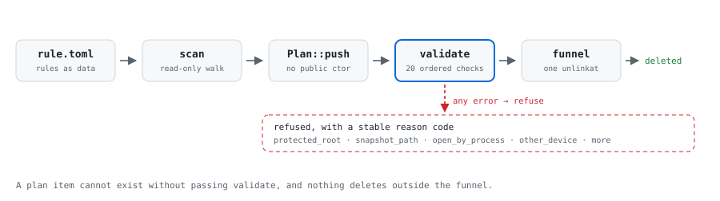
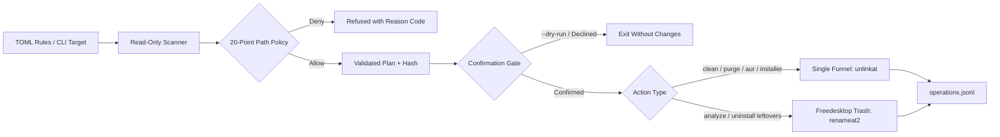
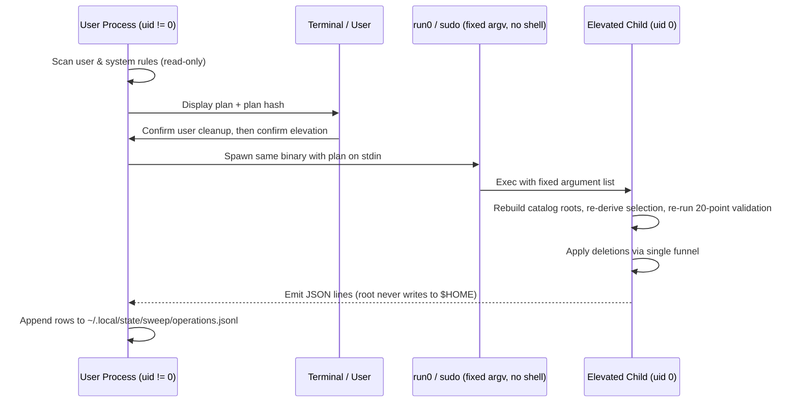
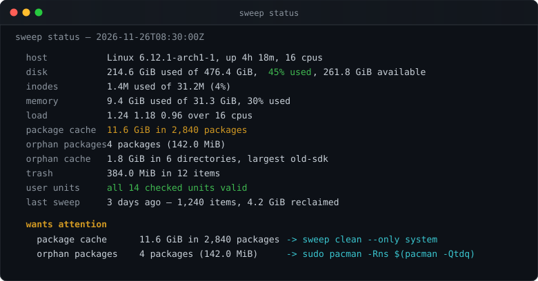
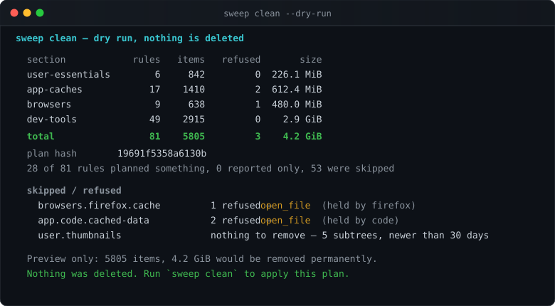
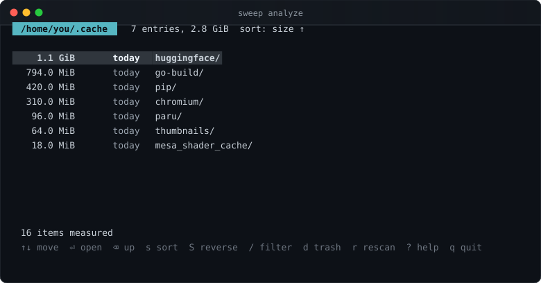
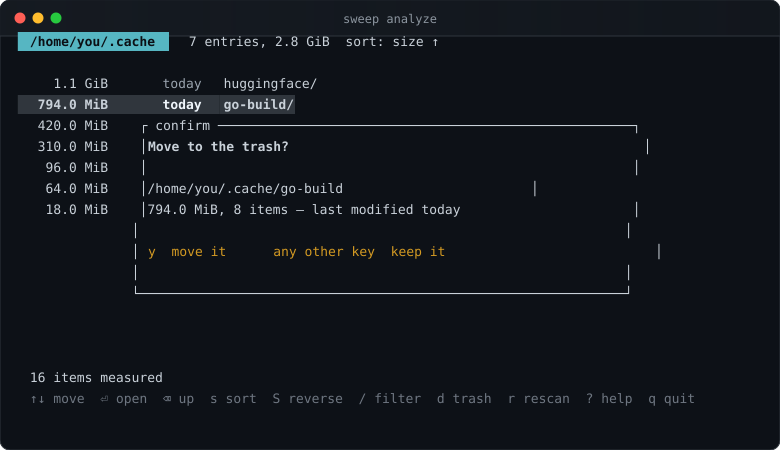
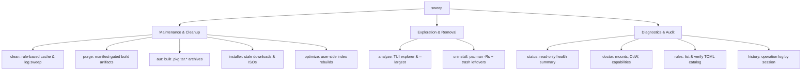

<div align="center">

# sweep

**Safe, previewable disk cleanup and system health for Arch Linux, with one validated way to delete a file.**

[](https://github.com/ulaskizilay/sweep/actions/workflows/ci.yml)
[](LICENSE)
[](rust-toolchain.toml)
[](#requirements)

<br>


<sub><code>sweep doctor</code>: inspects mounts, copy-on-write filesystems, snapshot trees, and kernel capabilities before anything runs.</sub>

</div>

---

## Overview

`sweep` reclaims cache, log, build artifact, and package space on Arch Linux without risking system files, active databases, or snapshots. Every destructive operation goes through a read-only planning phase, a human confirmation gate, and a single validated deletion funnel (or moves recoverable items to the freedesktop trash).

- **One deletion funnel**: Every `clean` path passes twenty checks before reaching a single non-recursive `unlinkat` syscall.
- **Fail-closed by design**: Missing mount info, unreadable `/proc` entries, or active file handles always result in a refusal with a stable reason code.
- **Never runs as root**: `sweep` refuses `uid 0` (exit 78). System caches elevate only after user confirmation via `run0` or `sudo` with a fixed, shell-free argument list.
- **Recoverable where it counts**: `analyze` and `uninstall` leftovers move items to the trash (`renameat2`) instead of unlinking them.
- **Full audit trail**: Every deletion, trash move, and index rebuild is recorded in `~/.local/state/sweep/operations.jsonl`.

---

## Architecture & Safety Pipeline

<div align="center">

<picture>
  <source media="(prefers-color-scheme: dark)" srcset="docs/assets/pipeline-dark.svg">
  
</picture>

</div>



Four structural invariants hold across the codebase:

1. **`PlanItem` has no public constructor.** `Plan::push` is the only builder, and it invokes `validate` first.
2. **One function deletes.** `sweep_core::funnel::apply` is the sole filesystem-mutating path for deletions; everything else is read-only.
3. **Any uncertainty is a refusal.** Unreadable mounts, unknown filesystems, or open file handles in `/proc` deny rather than guess.
4. **Deletion cannot recurse.** `unlinkat` on a non-empty directory fails with `ENOTEMPTY` at the kernel level.

### Privilege Boundary (`--privileged`)

System caches under `/var/cache` and `/var/log` are cleaned without running the main tool as root:



---

## Terminal Previews

### System Health Snapshot (`sweep status`)

Read-only summary of disk usage, memory, package cache, orphan packages, unowned cache directories, trash, user systemd units, and the last sweep, with actionable next commands.

<div align="center">

</div>

### Previewing a Cleanup Plan (`sweep clean --dry-run`)

Shows every section, item count, refused paths with reasons, and the deterministic plan hash before touching a single byte.

<div align="center">

</div>

### Interactive Disk Explorer (`sweep analyze`)

Full-screen TUI to inspect directory sizes, sort by size/name/age, filter entries, and move chosen items to the freedesktop trash with a confirmation dialog.

<div align="center">

<br><br>

</div>

---

## Command Suite



| Command | Purpose |
|---|---|
| `sweep status` | Read-only health summary: disk, inodes, memory, package cache, orphans, trash, user units, last sweep (`--json` supported) |
| `sweep doctor` | Diagnostic report of mounts, btrfs CoW/snapshots, base directories, and kernel capabilities (`--json` supported) |
| `sweep rules list \| verify` | Inspect the 136-rule catalog across 16 sections and validate user overlays |
| `sweep clean` | Reclaim cache, log, and trash space; `--dry-run` previews, `--only <section>` targets one section, `--privileged` includes system caches |
| `sweep purge` | Remove project build artifacts (`node_modules`, `target`, `.venv`, etc.) only when paired with their manifest |
| `sweep aur` | Remove built `.pkg.tar.*` archives in `paru`, `yay`, and `trizen` caches while preserving PKGBUILDs and sources |
| `sweep installer` | Remove downloaded `.pkg.tar.zst`, `.deb`, `.iso`, and `.AppImage` installers from `XDG_DOWNLOAD_DIR` |
| `sweep analyze` | Interactive TUI disk explorer that moves selected entries to trash; `--largest N` lists top files for scripts |
| `sweep uninstall [pkg]` | Package inventory, or `pacman -Rs` transaction preview and removal with exact-name leftover trashing |
| `sweep optimize` | Rebuild user-side fontconfig, application, and MIME indexes via their owning tools |
| `sweep history` | Read back `~/.local/state/sweep/operations.jsonl` grouped by session (`--verbose`, `--json`) |
| `sweep completions <shell>` | Print shell completions for `bash`, `zsh`, or `fish` |

---

## What It Protects

Every refusal returns a stable reason code rather than a silent skip:

| Protected Target | Enforcement |
|---|---|
| `/usr`, `/bin`, `/lib`, `/etc`, `/boot`, `/opt`, `/var/lib`, ... | Compile-time protected root list; no rule or config can narrow it |
| `~/.ssh`, `~/.gnupg`, `~/.password-store`, keyrings | Identity and credential stores are never treated as caches |
| `~/.cache`, `~/.config`, `~/.local/share`, `~/.local/state` | Base directories themselves are protected from whole-tree removal |
| Read-only & unknown mounts | Unknown or truncated mount tables deny all operations on affected paths |
| `/.snapshots`, `@snapshots`, `/timeshift` | Btrfs snapshot trees and rollback points are never modified |
| Mount points | Unmounting via directory removal is refused |
| Foreign-owned, sticky-parent, and immutable files | Kernel ownership and flags are respected |
| Open files (`/proc` inode scan) | Files held open by running processes (and `-wal`/`-shm` of open DBs) are refused |

Symlinked ancestors (such as `~/.cache -> /mnt/ssd/cache`) are resolved to their physical path, re-checked against the full deny list, and opened with `RESOLVE_NO_SYMLINKS`. See [`docs/SAFETY.md`](docs/SAFETY.md) for the complete safety contract.

---

## Rules & Configuration

### Rule Catalog & User Overlays

The built-in catalog ships as TOML packs (`rules/01-system.toml` through `rules/16-model-caches.toml`, 136 rules across 16 sections). Add custom rules in `~/.config/sweep/rules.d/*.toml` and verify them with:

```bash
sweep rules verify
sweep rules list --verbose
```

See [`docs/RULES.md`](docs/RULES.md) for the full rule schema and retention kinds (`dir-sweep`, `dir-age`, `file-pattern`, `pkg-cache`, `hf-cache`, `versions`, `project-artifacts`, `report-only`, and more).

### User Ignore File

Protect specific paths or patterns permanently in `~/.config/sweep/ignore`:

```text
# Keep manual vendor checkouts
~/code/vendor-checkout

# Keep disk images anywhere
*.iso
```

### Key Safeguards by Workflow

- **Project artifacts (`sweep purge`)**: Only removes build directories sitting beside a matching manifest (`Cargo.toml` + `target`, `package.json` + `node_modules`). Stray directories without a manifest are skipped and reported.
- **AUR caches (`sweep aur`)**: Deletes only compiled `.pkg.tar.*` archives; clones, `PKGBUILD` recipes, and upstream sources are preserved.
- **Model weights (`--only model-caches`)**: Opt-in only. Uses `hf-cache` to remove unreferenced Hugging Face `blobs/` and `*.incomplete` files without breaking `snapshots/`.
- **Package cache (`pkg-cache`)**: Matches `paccache -k2` semantics using pacman's `vercmp` and keeps recently downloaded packages (`keep_days`) to preserve active downgrades.

---

## Requirements

- **OS**: Arch Linux, or Linux with `/proc/self/mountinfo`
- **Kernel**: Linux 5.6+ recommended for `openat2` (older kernels use a component-walk fallback with identical verdicts)
- **Build**: Rust 1.82+ (when building from source)

---

## Install

### Release Archive (x86_64 / aarch64)

```bash
gh release download -R ulaskizilay/sweep \
  -p 'sweep-*-x86_64-linux.tar.gz' -p SHA256SUMS
sha256sum -c SHA256SUMS
tar -xzf sweep-*-x86_64-linux.tar.gz
install -m755 sweep-*/bin/sweep ~/.local/bin/
```

### Arch Linux PKGBUILD

Two packages are maintained in [`packaging/`](packaging/README.md): `sweep-cli` (pinned release tag) and `sweep-cli-git` (tracks `main`):

```bash
git clone https://github.com/ulaskizilay/sweep.git
cd sweep/packaging/sweep-cli
makepkg -si
```

### Build from Source

```bash
git clone https://github.com/ulaskizilay/sweep.git
cd sweep
cargo build --release --locked
./target/release/sweep doctor
```

### Completions & Man Pages

```bash
sweep completions bash > /usr/share/bash-completion/completions/sweep
sweep completions zsh  > /usr/share/zsh/site-functions/_sweep
sweep completions fish > /usr/share/fish/vendor_completions.d/sweep.fish

sweep __manpage       > /usr/share/man/man1/sweep.1
sweep __manpage clean > /usr/share/man/man1/sweep-clean.1
```

---

## Documentation

| Document | Contents |
|---|---|
| [`docs/SAFETY.md`](docs/SAFETY.md) | Full safety contract, 20-point path policy, and residual risks |
| [`docs/RULES.md`](docs/RULES.md) | TOML rule schema, retention kinds, and load-time refusals |
| [`docs/ORPHAN_DATA.md`](docs/ORPHAN_DATA.md) | Design notes for orphan cache directory detection |
| [`docs/ARTIFACT_CANDIDATES.md`](docs/ARTIFACT_CANDIDATES.md) | Thresholds and criteria for build artifact detection |
| [`packaging/README.md`](packaging/README.md) | Release packaging and PKGBUILD details |

---

## License

[MIT](LICENSE)
